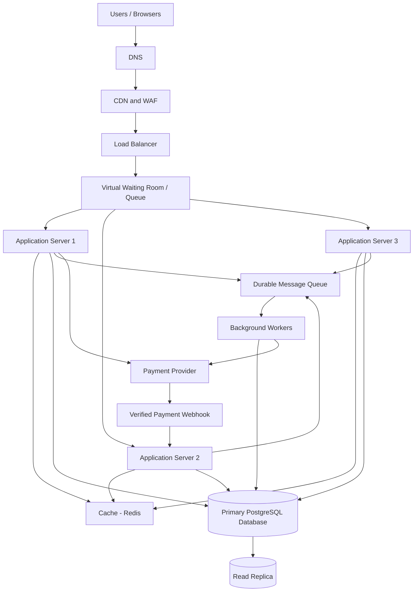

# TicketHub — Event Ticketing System Design

## 1. Requirements

TicketHub is a website where users can discover events, view available seats, purchase tickets, make payments, and access their purchased tickets. The system must support normal daily activity and sudden traffic spikes when popular concerts go on sale.

### 1.1 Functional requirements

The system must allow users to:

1. Register, log in, and manage their accounts.
2. Browse events and view event details, dates, venues, and ticket prices.
3. View a seat map and check seat availability.
4. Select and temporarily hold available seats during checkout.
5. Pay for held seats using a payment provider.
6. Receive an order confirmation and access their purchased tickets.
7. View their previous orders and ticket details.
8. Cancel eligible orders and receive refunds according to the event's policy.
9. Allow administrators to create events, configure seats, set prices, and monitor sales.

### 1.2 Non-functional requirements

| Requirement | Target or explanation |
|---|---|
| Performance | Normal event and seat-availability reads should have a target response time below 300 ms at the 95th percentile, excluding external payment processing. |
| Peak performance | The system should support at least 2,000 incoming API requests per second during a major sale, with capacity to scale further based on load tests. |
| Correctness | A physical seat must never be confirmed for two different orders for the same event. |
| Fairness | Use a virtual waiting room, a fair queueing policy, and time-limited seat holds. Do not let users bypass the queue by repeatedly refreshing. |
| Availability | Event browsing should remain available during a sale even if some checkout operations are temporarily delayed. |
| Security | Use authenticated sessions, role-based access, encrypted connections, and server-side price and ownership validation. |
| Reliability | Retry-safe payment and order operations must prevent duplicate charges or duplicate confirmed tickets. |
| Scalability | Add application servers and supporting capacity when traffic increases. |
| Maintainability | Use documented APIs, automated tests, monitoring, and clear separation between application components. |

The performance figures are design targets, not guarantees. They must be verified through load testing.

## 2. Traffic estimates

### 2.1 Given facts and assumptions

- Registered users: 2,000,000.
- Normal daily visitors: 50,000.
- Pages viewed per normal-day visitor: 10.
- Tickets sold on a normal day: 5,000.
- Big-sale visitors attempting to buy tickets: 200,000 within 10 minutes.
- Seats available for the popular concert: 20,000.

For calculations, one day contains 86,400 seconds and the big-sale window contains 600 seconds. The estimates below use average traffic across each window; actual traffic may arrive in much sharper bursts.

### 2.2 Normal-day traffic

**Page views per day**

50,000 visitors × 10 pages = 500,000 page views per day.

**Average page views per second**

500,000 ÷ 86,400 ≈ 5.79 page views per second.

**Average tickets sold per second**

5,000 ÷ 86,400 ≈ 0.058 tickets per second.

This is approximately one ticket sold every 17 seconds on average.

### 2.3 Big-sale traffic

**People attempting to buy per second**

200,000 ÷ 600 ≈ 333.33 people per second.

**Maximum successful seat sales per second**

20,000 seats ÷ 600 ≈ 33.33 seats per second if every seat is sold evenly across the ten minutes.

**Demand compared with supply**

200,000 people ÷ 20,000 seats = 10 people per seat.

Only 10% of those people could obtain one of the 20,000 seats if each person wants one seat and all seats are sold. The system must communicate unavailability fairly rather than sell seats it does not have.

### 2.4 Comparison

| Metric | Normal day | Big sale |
|---|---:|---:|
| Visitors or purchase attempts | 50,000 visitors/day | 200,000 attempts/10 minutes |
| Page views or attempts per second | 5.79 page views/s on average | 333.33 purchase attempts/s on average |
| Tickets or seats | 5,000 tickets/day | 20,000 seats in 10 minutes |
| Average successful sales rate | 0.058 tickets/s | Up to 33.33 seats/s |
| Main challenge | Efficient everyday operation | Sudden demand, fairness, and seat contention |

The big-sale purchase-attempt rate is approximately 57.6 times the normal page-view rate. These are different types of activity, so this ratio is only a rough indicator of the increased pressure; it is not a direct comparison of equivalent API requests.

Each user may generate several API requests. If every one of the 200,000 people makes six requests during the ten-minute sale, the system receives 1.2 million requests, averaging 2,000 requests per second. This is the basis for the initial peak API capacity target. Real traffic should be measured and load-tested before production.

## 3. API design

The API uses REST conventions and JSON request and response bodies. All endpoints use HTTPS. Authenticated endpoints require a valid session or access token.

Base URL: `/api/v1`

| Method | Endpoint | Purpose | Success status |
|---|---|---|---|
| GET | `/events` | Browse events, with pagination and filters | 200 OK |
| GET | `/events/{eventId}` | View event details | 200 OK |
| GET | `/events/{eventId}/seats` | View seats and their current availability | 200 OK |
| POST | `/events/{eventId}/holds` | Temporarily hold selected seats | 201 Created |
| POST | `/orders` | Create a pending order from valid seat holds | 201 Created |
| POST | `/orders/{orderId}/payments` | Initiate or confirm payment through the payment service | 202 Accepted |
| GET | `/me/orders` | View the authenticated user's orders | 200 OK |
| GET | `/me/tickets` | View the authenticated user's purchased tickets | 200 OK |

### 3.1 Browse events

Request:

`GET /api/v1/events?page=1&limit=20`

Example response:

```json
{
  "items": [
    {
      "id": 101,
      "name": "Summer Music Festival",
      "venue": "City Arena",
      "date": "2027-06-20",
      "startingPrice": 2500
    }
  ],
  "page": 1,
  "limit": 20,
  "total": 125
}
```

The endpoint supports pagination so the server does not need to return every event at once.

### 3.2 View seats

Request:

`GET /api/v1/events/101/seats`

Example response:

```json
{
  "eventId": 101,
  "seats": [
    {
      "id": 501,
      "label": "A-01",
      "price": 2500,
      "status": "available"
    },
    {
      "id": 502,
      "label": "A-02",
      "price": 2500,
      "status": "held"
    }
  ]
}
```

Seat availability is only a snapshot. A seat shown as available may be taken before a user submits a hold request. The database must verify availability again when creating a hold.

### 3.3 Hold seats

Request:

`POST /api/v1/events/101/holds`

```json
{
  "seatIds": [501],
  "idempotencyKey": "hold-request-abc123"
}
```

Example response:

```json
{
  "holdId": "hold-789",
  "eventId": 101,
  "seatIds": [501],
  "status": "active",
  "expiresAt": "2027-06-20T10:15:00Z"
}
```

The server validates that the seats belong to the event and are available. It creates a time-limited hold, for example five minutes. If a seat is already held or sold, the request fails with `409 Conflict`.

### 3.4 Create an order

Request:

`POST /api/v1/orders`

```json
{
  "holdId": "hold-789",
  "idempotencyKey": "order-request-xyz456"
}
```

Example response:

```json
{
  "orderId": "order-1001",
  "status": "pending_payment",
  "amount": 2500,
  "currency": "KES"
}
```

The server derives the price from trusted database records instead of accepting a client-provided total. The hold must belong to the authenticated user and must not have expired.

### 3.5 Process payment

Request:

`POST /api/v1/orders/order-1001/payments`

```json
{
  "paymentMethod": "mobile_money",
  "idempotencyKey": "payment-request-pay123"
}
```

Example response:

```json
{
  "orderId": "order-1001",
  "paymentStatus": "processing"
}
```

The payment service may respond asynchronously. A verified payment-provider callback updates the payment and order state. The callback must be authenticated and processed idempotently so that duplicate callbacks do not create duplicate tickets.

### 3.6 View purchased tickets

Request:

`GET /api/v1/me/tickets`

Example response:

```json
{
  "tickets": [
    {
      "ticketId": "ticket-5001",
      "eventId": 101,
      "eventName": "Summer Music Festival",
      "seatLabel": "A-01",
      "status": "confirmed"
    }
  ]
}
```

The server returns tickets belonging to the authenticated user only.

### 3.7 Error handling

The API uses appropriate HTTP status codes:

- `400 Bad Request` — invalid request data.
- `401 Unauthorized` — missing or invalid authentication.
- `403 Forbidden` — user lacks permission.
- `404 Not Found` — event, seat, or order does not exist.
- `409 Conflict` — seat is already held or sold, or the requested state transition is invalid.
- `422 Unprocessable Content` — request data is valid JSON but violates a business rule.
- `429 Too Many Requests` — rate limit exceeded.
- `500 Internal Server Error` — unexpected server error.
- `503 Service Unavailable` — a required service is temporarily unavailable.

Example error response:

```json
{
  "error": {
    "code": "SEAT_UNAVAILABLE",
    "message": "The selected seat is no longer available."
  }
}
```

## 4. Data model

TicketHub uses a relational database such as PostgreSQL because ticket purchases require transactions, relationships, and strong consistency for seat ownership.

The design contains six tables: `users`, `events`, `seats`, `orders`, `order_items`, and `payments`.

### 4.1 Tables and columns

#### Users

| Column | Type | Purpose |
|---|---|---|
| id | BIGINT, primary key | Unique user identifier |
| name | VARCHAR(120) | User's name |
| email | VARCHAR(255), unique | Login and contact email |
| password_hash | VARCHAR(255) | Secure password hash |
| created_at | TIMESTAMP | Account creation time |

#### Events

| Column | Type | Purpose |
|---|---|---|
| id | BIGINT, primary key | Unique event identifier |
| name | VARCHAR(200) | Event name |
| venue | VARCHAR(200) | Event location |
| starts_at | TIMESTAMP | Event start time |
| status | VARCHAR(30) | Draft, published, or cancelled |
| created_at | TIMESTAMP | Record creation time |

#### Seats

Each seat belongs to one event.

| Column | Type | Purpose |
|---|---|---|
| id | BIGINT, primary key | Unique seat identifier |
| event_id | BIGINT, foreign key | References `events.id` |
| seat_label | VARCHAR(30) | Label such as A-01 |
| price | DECIMAL(10,2) | Ticket price |
| status | VARCHAR(20) | Available, held, or sold |
| hold_expires_at | TIMESTAMP, nullable | Expiry time for a temporary hold |
| hold_token | UUID, nullable | Identifier for the active hold |

A unique constraint on `(event_id, seat_label)` prevents the same seat label from being created twice for one event.

#### Orders

| Column | Type | Purpose |
|---|---|---|
| id | BIGINT, primary key | Unique order identifier |
| user_id | BIGINT, foreign key | References `users.id` |
| status | VARCHAR(30) | Pending payment, confirmed, failed, or cancelled |
| total_amount | DECIMAL(10,2) | Total order price |
| currency | CHAR(3) | Currency code, for example KES |
| idempotency_key | VARCHAR(100), unique | Prevents duplicate order creation on retries |
| created_at | TIMESTAMP | Order creation time |

#### Order items

An order item records which seat was purchased as part of an order.

| Column | Type | Purpose |
|---|---|---|
| id | BIGINT, primary key | Unique order-item identifier |
| order_id | BIGINT, foreign key | References `orders.id` |
| seat_id | BIGINT, foreign key | References `seats.id` |
| price_at_purchase | DECIMAL(10,2) | Price at the time of purchase |
| ticket_status | VARCHAR(20) | Pending, confirmed, cancelled, or refunded |

A unique constraint on `seat_id` in this table ensures that a seat can appear in at most one order item for the lifetime of this simple ticketing model. If resale or rebooking is supported later, the design should use a separate seat-allocation table with a unique constraint on the active allocation, rather than permanently preventing all future allocations.

#### Payments

| Column | Type | Purpose |
|---|---|---|
| id | BIGINT, primary key | Unique payment identifier |
| order_id | BIGINT, foreign key | References `orders.id` |
| provider_reference | VARCHAR(150), unique | Payment provider's transaction reference |
| idempotency_key | VARCHAR(100), unique | Prevents duplicate payment attempts |
| amount | DECIMAL(10,2) | Amount requested or paid |
| status | VARCHAR(30) | Pending, successful, failed, or refunded |
| created_at | TIMESTAMP | Payment creation time |

### 4.2 Relationships

- **Users to orders: one-to-many.** One user can create many orders, but each order belongs to one user.
- **Events to seats: one-to-many.** One event contains many seats, and each seat belongs to one event.
- **Orders to order items: one-to-many.** One order may contain several seat purchases.
- **Seats to order items: one-to-one for a seat's lifetime in this simplified model.** Each seat can be recorded in at most one order item because of the unique `seat_id` constraint.
- **Orders to payments: one-to-many.** An order may have multiple payment attempts, but each payment belongs to one order.

The `order_items` table connects orders and seats and preserves the price paid for each seat. The separate `payments` table records payment attempts and provider references without mixing payment history into the order record.

### 4.3 Preventing double-booking

**The database—not the cache or the user interface—guarantees that two people cannot purchase the same seat.**

TicketHub uses the following safeguards:

1. The application starts a database transaction when a user requests a seat hold.
2. The database conditionally changes the seat from available to held only if it is still available or its previous hold has expired.
3. The update locks the relevant row while the transaction is running, so competing transactions cannot both successfully claim the same seat.
4. A unique constraint on `order_items.seat_id` provides a second layer of protection against creating two purchase records for the same seat.
5. The application confirms the purchase only after payment has been verified and the seat allocation has been safely committed.
6. An expired hold can be released through a transaction. A background worker can identify expired holds, but it must not release a seat whose hold has already been renewed or converted into a confirmed purchase.

A simplified conditional update could look like this:

```sql
BEGIN;

UPDATE seats
SET status = 'held',
    hold_token = '11111111-1111-1111-1111-111111111111',
    hold_expires_at = CURRENT_TIMESTAMP + INTERVAL '5 minutes'
WHERE id = 501
  AND (
      status = 'available'
      OR (
          status = 'held'
          AND hold_expires_at < CURRENT_TIMESTAMP
      )
  )
RETURNING id;

COMMIT;
```

The application must check the result of `RETURNING id`. If no row is returned, the seat was not claimed and the user must be told it is unavailable. The example illustrates the principle; a production implementation must also validate the event and user, and coordinate hold creation with the relevant order or hold record inside a transaction.

The order-creation flow must verify that every requested seat is still held by that user and that the hold has not expired. The final allocation and order-item insertion must be transactional, with the unique constraint enforced by the database. If two users attempt to buy the same seat at the same time, only one transaction can claim it successfully. The other receives a conflict response.

Payment processing requires additional care because an external payment provider cannot participate in the database transaction. TicketHub should use idempotency keys, verified provider callbacks, a durable payment state machine, and reconciliation for uncertain outcomes. A failed or delayed payment must not cause the system to issue two confirmed tickets.

## 5. Architecture

### 5.1 Architecture diagram



The diagram is a logical overview. In production, the application servers, workers, database, cache, and queue should be deployed with appropriate redundancy, security, and monitoring.

### 5.2 Component explanations

1. **Users / browsers:** Let customers browse events, select seats, pay, and view tickets.
2. **DNS:** Resolves the TicketHub domain to the appropriate entry point.
3. **CDN and Web Application Firewall (WAF):** Delivers static files from nearby locations and filters common malicious traffic.
4. **Load balancer:** Distributes incoming requests across healthy application servers and removes unhealthy instances from service.
5. **Virtual waiting room:** Controls the rate at which users enter the sale and gives users a fair, ordered opportunity to proceed.
6. **Application servers:** Validate requests, enforce business rules, authenticate users, create orders, and communicate with other services. Multiple instances allow horizontal scaling.
7. **Redis cache:** Stores frequently read event details and other cacheable data to reduce repeated database reads. It is not the source of truth for seat ownership.
8. **Primary PostgreSQL database:** Stores authoritative seat states, holds, orders, and payments. Transactions and constraints enforce purchase correctness.
9. **Read replica:** Serves suitable read queries, such as historical order or event information, to reduce load on the primary. Seat availability and purchase decisions must use sufficiently current authoritative data.
10. **Durable message queue:** Stores background jobs such as sending confirmations, processing events, and scheduling reconciliation work.
11. **Background workers:** Process queued jobs, release eligible expired holds, send notifications, and reconcile payment outcomes. Jobs should be safe to retry.
12. **Payment provider:** Processes payments externally and sends signed or otherwise verified notifications about payment outcomes.
13. **Monitoring and alerting:** Collects latency, error rates, queue depth, database contention, and payment failures so operators can respond to problems.

### 5.3 How the architecture handles a big sale

- Static event pages, images, and other cacheable assets are delivered through the CDN.
- Event browsing uses caching and pagination to reduce repeated database work.
- The waiting room limits how quickly users reach checkout, protecting the database from a sudden burst.
- Multiple application servers handle concurrent requests, and the load balancer routes traffic to healthy servers.
- The primary database serializes conflicting seat allocations through transactions and constraints.
- The queue moves non-critical work, such as emails, away from the synchronous checkout path.
- Rate limits and request timeouts protect services from overload.
- Autoscaling adds application capacity when monitoring indicates demand has increased, subject to tested limits.
- If a payment provider is slow, the system shows a pending state rather than incorrectly declaring the order successful.
- The system should use replicated infrastructure, database backups, health checks, and tested recovery procedures to reduce single points of failure.

The waiting room improves fairness and protects the backend, but it does not guarantee that every visitor will get a ticket. With ten people competing for each seat, some users will be unsuccessful.

## 6. Trade-offs and alternatives considered

### 6.1 Strong consistency versus read performance

**Choice:** Use the primary relational database for seat holds and final allocations, and use caches or replicas for suitable read-only data.

**Benefit:** Transactions and database constraints prevent conflicting seat allocations.

**Cost:** The primary database can become a bottleneck during a popular sale. Some reads may also be slower if they must go to the primary.

**Alternative considered:** Use the cache to decide which user owns a seat.

**Why it was not chosen:** Cache updates and expiry are not a sufficient correctness guarantee for financial transactions. The database must remain authoritative.

### 6.2 Fair waiting room versus immediate access

**Choice:** Introduce a virtual waiting room for exceptionally popular sales.

**Benefit:** It controls admission rates, improves fairness, and reduces the risk of overwhelming the backend.

**Cost:** Users may have to wait even when some seats are still available, and the queue adds another component to operate.

**Alternative considered:** Allow all visitors to reach checkout simultaneously.

**Why it was not chosen:** A sudden burst can overload application servers and the database, increasing failures and unfair outcomes.

### 6.3 Synchronous work versus asynchronous processing

**Choice:** Keep seat allocation and the necessary order-state changes in the synchronous transaction, while sending email notifications and other non-critical tasks to background workers.

**Benefit:** The checkout path stays focused on the operations needed to preserve correctness, and slow notifications do not block ticket purchases.

**Cost:** Users may receive confirmation messages later, and the queue and workers require monitoring and retry handling.

**Alternative considered:** Perform every task before returning from checkout.

**Why it was not chosen:** Slow external services and notification delivery would increase checkout latency and could cause avoidable failures.

### 6.4 SQL database versus NoSQL database

**Choice:** Use PostgreSQL for transactional ticketing data.

**Benefit:** Relational constraints, transactions, joins, and unique indexes are well suited to orders, payments, and seat allocation.

**Cost:** Highly contended seats can cause row-lock waits and reduce write throughput. The schema also requires careful migration management.

**Alternative considered:** Use a NoSQL database as the sole source of truth.

**Why it was not chosen:** A NoSQL system may scale certain workloads well, but TicketHub still needs clear and enforceable guarantees for unique seat ownership. PostgreSQL is a straightforward fit for these requirements.

## Conclusion

TicketHub must handle both everyday event browsing and intense, short-lived demand for popular concerts. The design uses a scalable application tier, a waiting room, caching for suitable reads, and asynchronous workers for non-critical tasks. Most importantly, it relies on database transactions, conditional updates, and unique constraints—not the interface or cache—to prevent double-booking. Performance targets should be validated with realistic load tests before the system is released.
